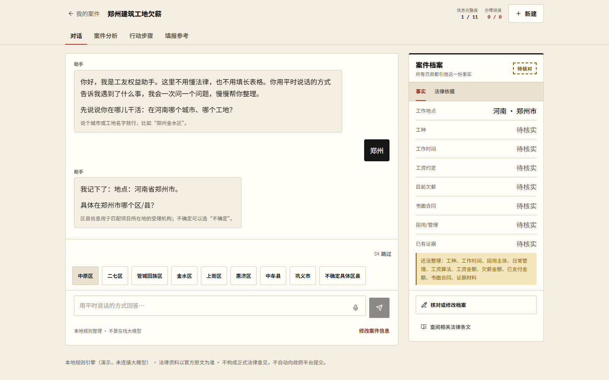
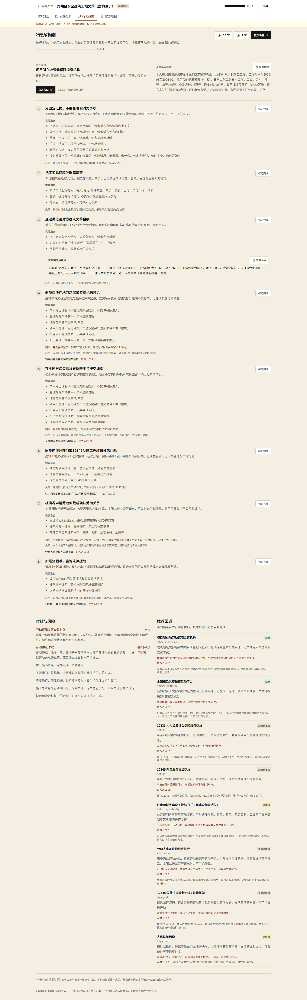
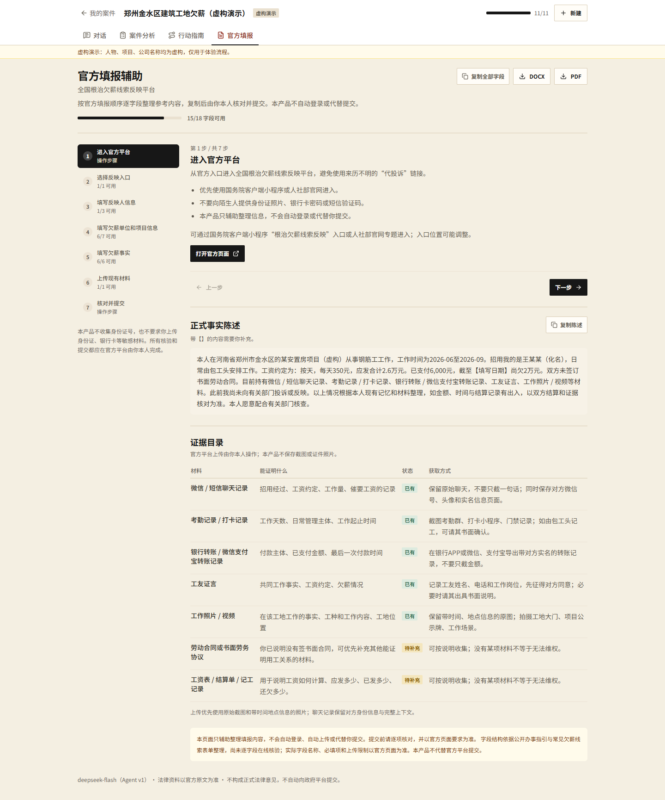

# 工友权益助手（WorkerRights）

2026 Qoder 高校创造力大赛 · Hack4Good 技术向善赛道作品。首期面向河南建筑工地欠薪场景。

**在线体验：[打开工友权益助手](https://workerrights-4uqvdfi8onc.qoder.zone/)**  
Qoder Sites 公开部署，访客无需登录或填写 API Key。首次体验可在首页打开虚构演示案件。

工资拖着没发、手里只有聊天记录、不知道先找谁时，可以先用自己的话说清经过。助手会帮你核对还有多少钱没到账、整理手上的材料，并列出可以继续做的事。

## 功能

- **欠薪咨询** — Qoder Cloud Agents（QCA）提供流式多轮对话，结合当前案件已记录的事实追问。
- **工资与证据整理** — 记录工期、工种、应发、已付和欠付工资，区分答应付款与实际到账，梳理聊天记录、记工和转账等材料。
- **案件分析** — 汇总用工关系、证据缺口、相关条文和可参考的办理渠道，保留来源和核验状态。
- **行动指南** — 按步骤准备材料，生成可编辑的沟通草稿、事实陈述和证据目录。
- **填报参考与导出** — 整理官方平台所需字段，支持逐项复制及 TXT、DOCX、PDF 导出，由用户自行核对和提交。
- **案件管理** — 在同一浏览器继续整理案件，也可删除案件或打开虚构演示。桌面和手机均可使用。

## 界面预览

以下为仓库留存的界面验收截图，最新页面请以在线体验为准。更多截图见 [设计验收记录](docs/redesign/)。

| 对话接待 | 行动指南 | 填报参考 |
| --- | --- | --- |
|  |  |  |

## 仓库结构

```text
frontend/           React 页面、组件和 API 客户端
  app/              首页、对话、案件分析、行动指南和填报参考
  sites/            Qoder Sites 的 Vite 入口与路由适配
backend/            本地 FastAPI、SQLite、Agent 和业务规则
sites-functions/    线上 Deno Edge Functions、数据库定义和迁移测试
  app/core/         事实、法律检索、派生结果和导出
  app/qca/          QCA 会话、流式事件与服务端工具调用
knowledge/          法律、地区及官方渠道数据
tests/              本地后端和前端回归测试
docs/               产品、架构、接口和设计验收文档
```

## 本地运行

建议使用 Node.js 24 和 Python 3.11 或以上版本。在仓库根目录启动后端。

```powershell
py -3 -m venv .venv
.\.venv\Scripts\python.exe -m pip install -r backend/requirements.txt
.\.venv\Scripts\python.exe -m backend.database.init_db
.\.venv\Scripts\python.exe -m uvicorn backend.main:app --host 127.0.0.1 --port 8000
```

另开一个终端，在仓库根目录执行以下命令。

```powershell
cd frontend
npm ci
npm run dev
```

打开 [本地前端](http://localhost:3000)。本地 API 文档在 [FastAPI Docs](http://127.0.0.1:8000/docs)。本地默认通过规则模式演示。如需调试本地真实模型，可按 [环境变量示例](.env.example) 设置服务端配置，接入说明见 [Agent v1](docs/agent-v1.md)。

## 测试与构建

以下命令从仓库根目录执行。

```powershell
.\.venv\Scripts\python.exe -m pytest tests -q
node --experimental-strip-types --test sites-functions/dev/*.test.mjs

cd frontend
npm test
npx tsc --noEmit
npm run build:sites
```

`npm run build:sites` 生成用于发布的 `frontend/dist/`。使用 `npm run build` 构建 Next.js 本地完整版。

## 技术要点

| 环境 | 前端 | 后端 | 咨询 |
| --- | --- | --- | --- |
| 线上 | Vite 构建的 React 应用 | Qoder Sites Functions 和平台数据库 | Qoder Cloud Agents |
| 本地 | Next.js 和 React | FastAPI 和 SQLite | 默认规则模式，可配置 OpenAI 兼容服务 |

- **工具回传** — QCA 请求工具时，由站点后端执行事实记录、工资核对或法律检索，再按调用 ID 返回结果。案件分析、行动指南和填报参考沿用业务规则。
- **会话与恢复** — 按访客和案件隔离数据。流式请求重连时复用请求标识，避免同一条消息重复写入。更正事实后，基于旧事实生成的结果会标记为过期。
- **数据边界** — 云端咨询会将必要的消息和案件上下文交给 QCA 处理。请勿输入身份证号或银行卡号。产品提供信息整理和办理参考，正式办理由用户在官方渠道完成。部分地方资料仍待核验，请以官方发布为准。

进一步阅读 [产品需求](docs/product-requirements.md)、[系统架构](docs/architecture.md)、[API 参考](docs/api-reference.md) 和 [法律数据规范](docs/legal-data-schema.md)。

## 赛事信息

- **比赛** — 2026 Qoder 高校创造力大赛（天池 532536）。
- **赛道** — Hack4Good 技术向善。
- **交付** — Qoder Sites 在线应用与 GitHub 源码。

## 许可证

代码采用 [MIT License](LICENSE)。法律法规引用以官方发布文本为准。
